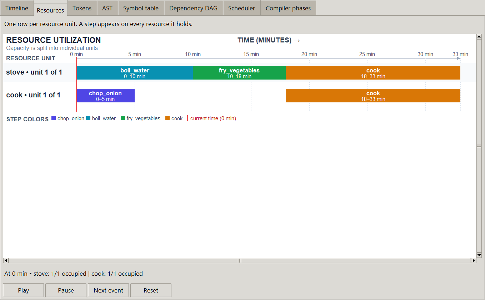
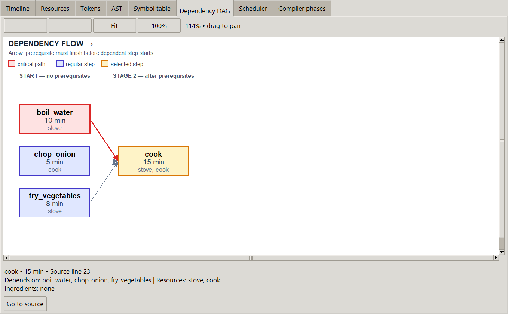
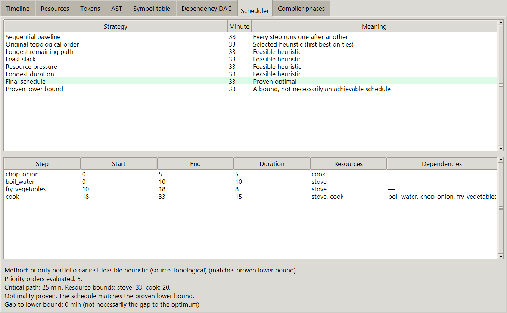

# RecipeLang

RecipeLang is a small domain-specific language compiler that turns a recipe into a validated, resource-aware cooking schedule.

```text
Source → Lexer → Parser → AST → Semantic analysis → Dependency DAG
       → Critical path → Resource scheduler → Validator → Timeline
```

The included demo improves a 38-minute sequential recipe to **33 minutes** while respecting its dependencies and limited stove/cook capacity.



## What it includes

- Hand-written lexer and parser with tokens, source locations and an AST
- Semantic checks for names, units, quantities, cycles and resource references
- Dependency graph, critical-path analysis and parallelism detection
- Five scheduling priorities plus bounded exact search for small recipes
- Independent validation of dependencies, durations and resource capacity
- Live compilation phases, simulation, resource lanes and JSON/CSV/PNG exports
- Syntax highlighting, clickable errors, example recipes and safe file handling

## Quick start

Requires Python 3.10+ and Tkinter.

```powershell
# Windows
python -m venv .venv
.\.venv\Scripts\python -m pip install -r requirements.txt
.\.venv\Scripts\python gui.py
```

```bash
# Ubuntu / WSL2
sudo apt install python3-tk
python3 -m venv .venv
. .venv/bin/activate
python -m pip install -r requirements.txt
python gui.py
```

Run the compiler from a terminal:

```bash
python recipelang.py examples/demo.recipe
```

## Language example

```text
ingredient onion 2 pcs
resource stove 1

step chop_onion
  duration 5 min
  takes onion 1 pcs
end

step fry_onion
  needs chop_onion
  uses stove
  duration 8 min
end
```

Supported units: `pc`, `pcs`, `mg`, `g`, `kg`, `ml`, `l`, `cup`, `cups`, `tsp`, `tbsp`. Durations may use `min`, `hr` or `sec` when they resolve to whole minutes.

## Workbench

Choose a recipe from the example menu and press **Compile + Optimize** or `F5`.

- **Compiler phases** shows the eight real stages as they run.
- **Dependency DAG** supports zoom, pan, node inspection and source navigation.
- **Scheduler** compares every heuristic, the final schedule and its lower bound.
- **Timeline** explains why each step is running, waiting or complete.
- **Resources** shows which step occupies each resource unit during playback.

### Reading the visualizations

- In **Resources**, time runs left to right in minutes. Each row is one available resource unit; a colored bar shows which step holds it and for how long.
- In **Dependency DAG**, stages run left to right. Each arrow points from a prerequisite to the step that must wait for it. Red nodes and arrows mark the critical path; amber marks the selected step.
- In **Scheduler**, the top table compares completion times. The lower table shows the chosen start/end times, resources and dependencies.





## Scheduling

The scheduler tries the original topological order, longest remaining path, least slack, resource pressure and longest duration. Each candidate uses earliest feasible placement.

For recipes with up to eight steps, bounded event-time search attempts to prove the best schedule optimal. The GUI states whether optimality was proved, skipped due to size, or left unproved after the search budget.

## Tests

```bash
python -m unittest discover -s tests -v
```

The suite contains **67 tests** covering compiler phases, scheduling, validation, exports, simulation, CLI behavior and real Tkinter interactions.

## Project layout

```text
recipelang.py          compiler and scheduler
gui.py                 visual workbench
editor.py              source editor and diagnostics
simulation.py          playback and resource lanes
schedule_validator.py  independent schedule checker
exporters.py           JSON, CSV and PNG exports
examples/              valid and invalid RecipeLang programs
tests/                 automated test suite
```

The original verified Review 2 release is preserved in Git as tag `original-review2`.
